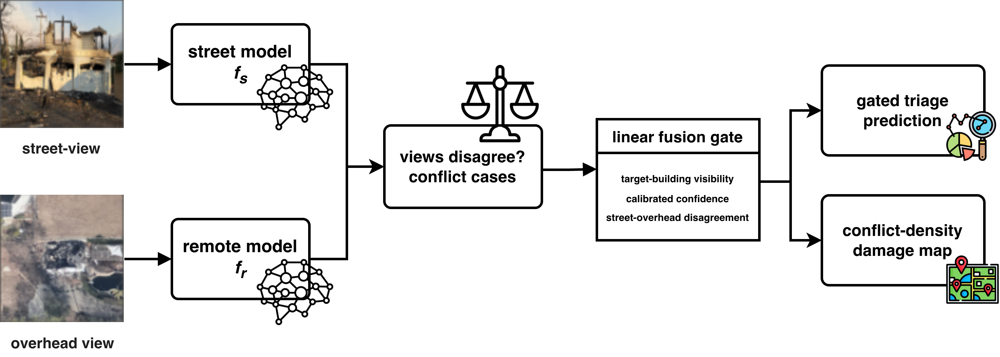
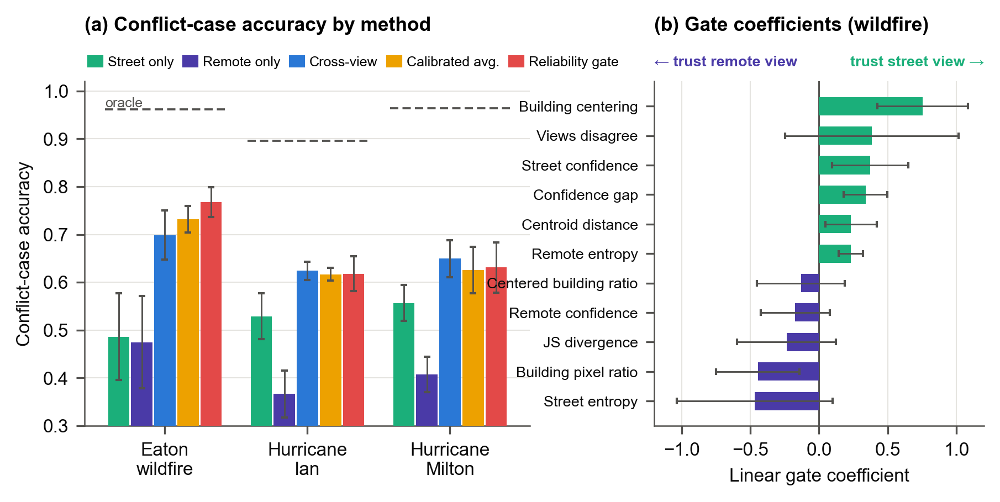
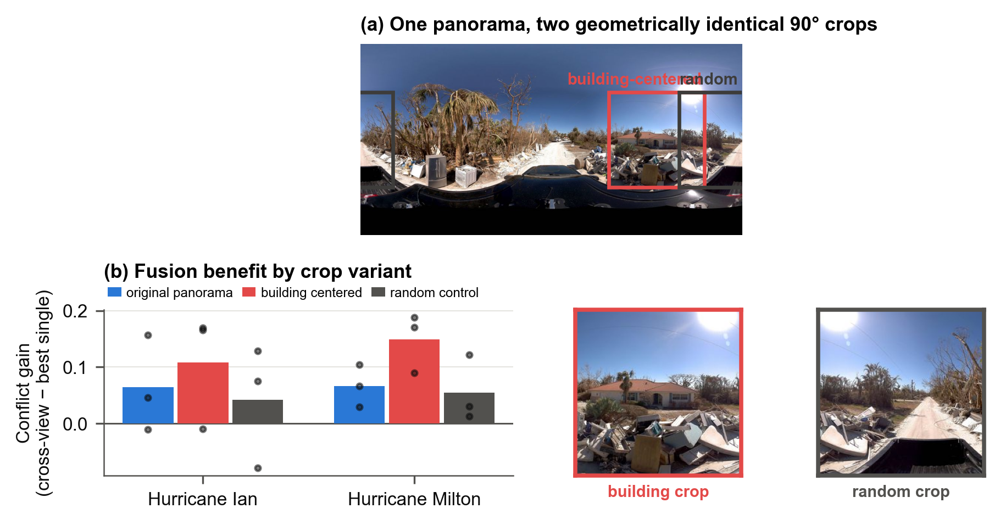
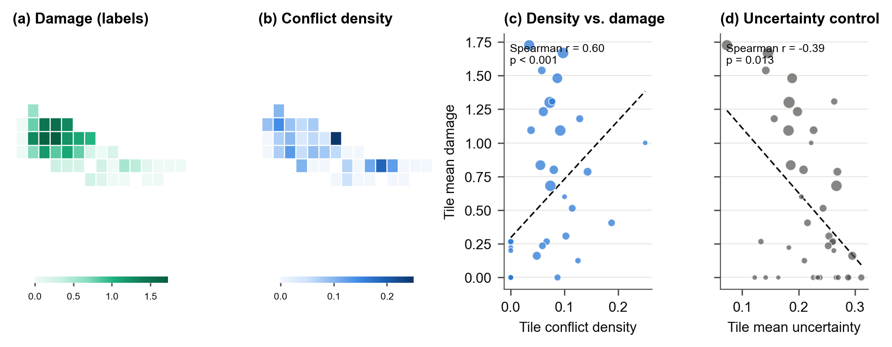
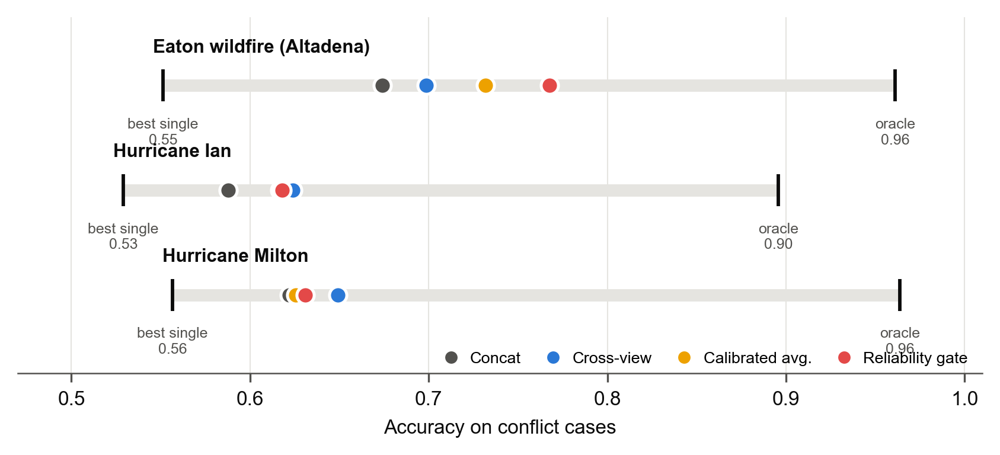

<div align="center">

# CrossViewGate

**When Satellite and Street Views Disagree**<br>
*Cross-view complementarity in disaster damage assessment, studied through conflict cases*

[](paper/geosearch2026_short/main.pdf)
[](https://arxiv.org/abs/2610.04327)
[](https://rayford295.github.io/CrossViewGate/)
[](talk/geosearch2026/CrossViewGate_GeoSearch2026_slides.pdf)
[](https://github.com/rayford295/disaster-crossview-datasets)
[](LICENSE)



</div>

> **Accepted** as a lightning talk at the 5th ACM SIGSPATIAL Workshop on Searching and
> Mining Large Collections of Geospatial Data (**GeoSearch 2026**), Riverside, CA,
> 3 November 2026. Yifan Yang and Lei Zou, Department of Geography, Texas A&M University.
> Slides and speaker script: [`talk/geosearch2026/`](talk/geosearch2026/).

Satellite and street-view imagery see different parts of a damaged
building: roofs from above, facades and debris from the ground. Fusion
methods usually report that combining the two views raises average
accuracy, but average accuracy hides whether the complementary evidence is
actually used, because for most buildings the two views agree. CrossViewGate
studies the **conflict cases**, the samples on which independently trained
single-view models disagree, as a diagnostic subset. On conflicts, at least
one view carries evidence the other lacks, so they are where fusion either
uses complementary information or does not.

## Research questions

The paper asks four questions on paired street/overhead collections from the
2025 Eaton wildfire and Hurricanes Ian and Milton (five seeds, one converged
protocol):

1. **How much complementary headroom do fusion methods leave on conflict
   cases?** We compare each method with an oracle that selects whichever
   single view is correct.
2. **Can a simple, readable gate recover part of it** from cues about whether
   the ground image actually shows the building?
3. **Does aiming the ground view at the building change the value of
   fusion?** We vary framing *within* a dataset by controlled cropping.
4. **Does the spatial density of conflicts**, which needs no labels once the
   models are trained, **track damage?**

## Findings

- **The oracle gap.** Conflicts make up 9.6–33.2% of the test data. Fusion
  improves conflict accuracy over either view, yet an oracle that picks the
  correct single view per conflict remains 0.37–0.48 above the better single
  view and 0.19–0.32 above the best evaluated fusion method. Current fusion
  leaves most view-specific evidence unused.
- **The fusion gate.** A linear mixture over 11 features (building
  visibility from a frozen segmenter, calibrated per-view confidence,
  cross-view disagreement) assigns a per-sample weight to the street,
  overhead, and end-to-end fusion predictions. Where ground photographs are
  aimed at the building (Eaton), it beats end-to-end fusion by +0.072
  conflict accuracy and +0.018 on the full test set (both p < 10⁻⁴) and
  calibrated averaging by +0.051 (p = 0.0001). On the panoramic hurricane
  data, where the building is rarely prominent, it is statistically
  indistinguishable from end-to-end fusion. The two-expert variant reads as
  one rule: *weight the street view when it is confident and the building is
  centered in the frame.*
- **Field-of-view intervention.** Cropping hurricane panoramas to
  building-centered 90° windows raises the conflict gain of fusion (Ian
  0.064 → 0.109, Milton 0.067 → 0.149); random crops of identical geometry
  do not, in 6/6 dataset-seed pairs. Building-oriented framing is a driver of
  which view carries the evidence.
- **Label-free damage indicator.** Tile-level conflict density correlates
  with wildfire damage without annotations (Spearman r = 0.615, 25 tiles;
  nominal p, damage is spatially autocorrelated). Single-view uncertainty
  anti-correlates. The hurricane signal is weaker (Milton r = 0.289, n.s.).
- **A negative result.** Once single-view models are converged and
  calibrated, probability averaging is as strong as end-to-end learned
  fusion. Learning pays off when it decides per sample which view carries
  the evidence.

Which view carries the evidence depends on hazard and capture setting. On
property-centric wildfire photographs, visibility cues identify when the
street view is decisive. On panoramic hurricane imagery, calibrated averaging
or end-to-end fusion suffices, and framing ground photographs on structures
raises the value of fusion. Mining conflicts turns "does fusion help?" into
"which view carries the evidence, where, and why?".

## Results

Conflict-case test accuracy, five-seed means.

| Method | Eaton wildfire | Hurricane Ian | Hurricane Milton |
| --- | :---: | :---: | :---: |
| Street only | 0.486 | 0.529 | 0.557 |
| Overhead only | 0.475 | 0.367 | 0.407 |
| End-to-end cross-view fusion | 0.699 | **0.624** | **0.649** |
| Calibrated probability averaging | 0.732 | 0.617 | 0.626 |
| **Fusion gate (linear)** | **0.768** | 0.618 | 0.631 |
| *Oracle single view* | *0.961* | *0.896* | *0.964* |

<table>
  <tr>
    <td width="50%"></td>
    <td width="50%"></td>
  </tr>
  <tr>
    <td><sub><b>Fusion gate.</b> Accuracy by method and the coefficients of the two-expert (street vs. overhead) linear gate. Positive values shift weight toward the street view.</sub></td>
    <td><sub><b>Field-of-view intervention.</b> Same panorama, same crop geometry; the building-centered crop raises the fusion gain, the random crop does not.</sub></td>
  </tr>
  <tr>
    <td></td>
    <td></td>
  </tr>
  <tr>
    <td><sub><b>Label-free damage map.</b> Conflict density tracks labeled damage; uncertainty density does not.</sub></td>
    <td><sub><b>The oracle gap.</b> Each bar spans best single view to oracle; dots place each method.</sub></td>
  </tr>
</table>

Full tables, pooled paired tests, calibration decomposition, and ordinal
metrics are in [`docs/results/`](docs/results/README.md) (`_v2` = headline
five-seed protocol).

## Quick start

```bash
pip install -e .
bash scripts/run_multiseed_v2.sh                                   # converged 5-seed suite
python scripts/analyze_calibration_fusion.py --multiseed-root outputs/multiseed_v2 --seeds 42,123,456,789,1011
python scripts/train_reliability_gate.py     --multiseed-root outputs/multiseed_v2 --seeds 42,123,456,789,1011
python scripts/analyze_pooled_seed_tests.py  --multiseed-root outputs/multiseed_v2 --seeds 42,123,456,789,1011
python scripts/build_paper_figures.py                              # regenerate figures/
```

Imagery stays local; sources and split provenance are in
[`docs/datasets.md`](docs/datasets.md). The portable georeferenced Hurricane
Ian split lives in
[`disaster-crossview-datasets`](https://github.com/rayford295/disaster-crossview-datasets/tree/main/IAN_hurricane).

```text
crossview_conflict/   package: data, models, training, decision
scripts/              pipeline and analysis
tests/                protocol, provenance, and integrity tests
configs/              frozen experiment contracts
paper/                GeoSearch '26 short paper (LaTeX + PDF)
talk/                 GeoSearch '26 slides (PDF + PPTX) and speaker script
figures/              publication figures
docs/                 datasets, protocols, results, project website
```

**Terminology.** The paper calls the per-sample weighting model the *fusion
gate*. The code, result logs, and tests keep their original identifier
`reliability_gate` (for example `scripts/train_reliability_gate.py` and
`docs/results/reliability_gate_results_v2.md`) so that every number in the
paper still maps to the log it was checked against. The two names refer to
the same model.

## Beyond classification

A follow-up line asks when evidence is sufficient, which view to acquire next,
and when to defer to a human. Development results so far are transparent
No-Go or sensitivity-only findings, recorded with their consumed-data ledger in
[`docs/results/`](docs/results/README.md).

## Citation

```bibtex
@inproceedings{yang2026disagree,
  title     = {When Satellite and Street Views Disagree: Cross-View Complementarity
               in Disaster Damage Assessment},
  author    = {Yang, Yifan and Zou, Lei},
  booktitle = {Proceedings of the 5th ACM SIGSPATIAL International Workshop on
               Searching and Mining Large Collections of Geospatial Data (GeoSearch '26)},
  year      = {2026},
  doi       = {10.1145/3849732.3857333},
  eprint    = {2610.04327},
  archivePrefix = {arXiv},
  note      = {Lightning talk. Code: https://github.com/rayford295/CrossViewGate}
}
```

## Acknowledgments

Supported by the U.S. National Science Foundation (Award 2318206) and the
Gulf Research Program of the National Academies of Sciences, Engineering, and
Medicine (SCON-10000653 and SCON-10001536).

Formerly `CrossViewConflict` (old URLs redirect; the package import name stays
`crossview_conflict`). Licensed under [Apache 2.0](LICENSE).
